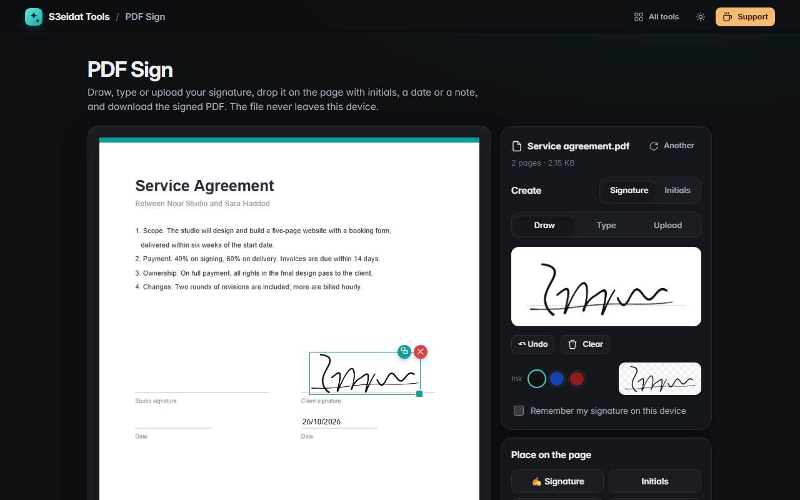

# PDF Sign

> Sign PDFs without uploading them. Draw, type or upload your signature, place it with initials, dates and text, and download. Free, private, and it runs entirely in your browser.

### ▶ [Open PDF Sign](https://s3eidat.github.io/pdf-sign/)



## Features

- **Draw** your signature with a smooth pen (line width follows your speed, and pen pressure on tablets), with undo and clear
- **Type** your name in a handwriting style; the styles come from fonts already on your device
- **Upload** a photo or scan of your signature; the white background is removed with an adjustable threshold
- Separate **initials**, plus **date** (five formats) and free **text** boxes
- **Click to place** on any page, **drag** to move, pull the corner to **resize**, arrow keys to nudge, double-click text to edit
- **Copy to every page** in one click (handy for initials)
- Ink in black, blue or dark red
- Correct placement on **rotated pages** and pages of **different sizes**
- Text is embedded as real, searchable PDF text; text the standard PDF font can't show (e.g. Arabic) is embedded as a sharp image instead
- Your signature is remembered **only if you tick the box**, and only in this browser

## Limits

- This stamps a picture of your signature onto the page, the same as signing paper. It is **not** a certificate-based (cryptographic) digital signature.
- Password-protected PDFs need their protection removed first.

## Privacy

Your PDF and your signature never leave your device. There is no server, no account, no analytics.
The page ships with a strict Content-Security-Policy (`connect-src 'self'`), so the browser
itself blocks any attempt to send data anywhere. Pages are drawn with [pdf.js](https://github.com/mozilla/pdf.js) (Apache-2.0)
and the signed file is written with [pdf-lib](https://github.com/Hopding/pdf-lib) (MIT), both included in `lib/`.

## Run it yourself

It's plain HTML, CSS and JavaScript with no build step:

```bash
git clone https://github.com/s3eidat/pdf-sign
cd pdf-sign
python -m http.server 8000
```

Then open http://localhost:8000.

## Support

If this saved you time, **[buy me a coffee ☕](https://s3eidat.github.io/coffee/)**. It keeps every tool free.

---

Part of **[S3eidat Tools](https://s3eidat.github.io/)**: 100+ free, private tools that run in your browser. MIT licensed.
